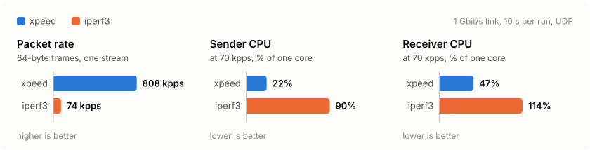

# Xpeed

[](https://github.com/Jorgeortiz97/xpeed/actions/workflows/ci.yml)
[](https://github.com/Jorgeortiz97/xpeed/releases/latest)
[](LICENSE)

**Up to 11× the packet rate of iperf3 from one core, with 4 to 6 times less
CPU at the same rate.**

<picture>
  <source media="(prefers-color-scheme: dark)" srcset="docs/benchmark-dark.svg">
  
</picture>

High-performance network benchmarking for Linux, powered by eBPF/XDP. It
works like iperf3 (client, server, TCP control channel, interval reports),
but both data paths run in XDP. Only UDP is supported for now.

## Quick start

Download a static binary (`x86_64` or `aarch64`):

```
curl -L https://github.com/Jorgeortiz97/xpeed/releases/latest/download/xpeed-x86_64-unknown-linux-musl.tar.gz | tar xz
```

Then run the server on the receiver and the client on the sender:

```
sudo xpeed-x86_64-unknown-linux-musl/xpeed server -B eth0
sudo xpeed-x86_64-unknown-linux-musl/xpeed client 10.0.0.2
```

## How it works

- **Client**: each stream replays a template UDP frame with `BPF_PROG_RUN`
  in live-frames mode. `xpeed_tx` stamps a sequence number and timestamp
  into every frame and redirects it to the egress interface. Tracepoints
  count the frames the driver accepted or dropped, which separates TX
  drops from network loss.
- **Server**: `xpeed_rx` counts matching packets per stream, tracks loss,
  reordering and RFC 3550 jitter, and drops them. Other traffic passes.
- **Control**: JSON over TCP on the same port. A per-test cookie keeps
  stray packets from being counted.

## Requirements

- Root, or `CAP_BPF`, `CAP_NET_ADMIN`, `CAP_PERFMON` (and `CAP_NET_RAW` for
  `-B <iface>` on the client).
- Client: Linux ≥ 5.18 and an egress driver that supports XDP redirect
  (`ndo_xdp_xmit`). A pass-through XDP program is attached when the driver
  needs one. DSA ports and e1000 can only receive.
- Server: Linux ≥ 5.2. On kernels before 5.9, `kill -9` leaves the program
  attached; remove it with `ip link set dev <iface> xdp off`.
- veth: the receiving end needs an XDP program or GRO enabled.
- Build: Rust ≥ 1.85, clang (or set `CLANG`) and `linux-libc-dev`.

## Build

```
cargo build --release
```

The end-to-end tests need root:

```
cargo test-root -- --include-ignored
```

## Usage

```
xpeed server -B enp1s0f0
xpeed client 10.0.0.2
xpeed client 10.0.0.2 --cpus 2-5 -s 1518 -b 9G -t 30
xpeed client 2001:db8::2 -B 2001:db8::1 --pps 2M -J
xpeed client 10.0.0.2 --vlan 100,200 --vlan-proto 802.1ad --dscp ef
```

| Option | Side | Meaning |
|---|---|---|
| `-B, --bind` | both | Server: interface, or local address (needed for IPv6 clients). Client: source address or egress interface. |
| `-p, --port` | both | Control and data port (default 5301). |
| `-m, --mode` | both | XDP mode: `auto`, `native` or `skb`. |
| `-i, --interval` | both | Seconds between reports. |
| `-1, --one-off` | server | Exit after one test. |
| `-t, --time` | client | Duration in seconds (default 10). |
| `-s, --size` | client | Frame size including FCS and VLAN tags (default: 64 for IPv4, 84 for IPv6, plus 4 per tag). |
| `-b, --bitrate` / `--pps` | client | Total rate (`k/M/G/T`); defaults to and is capped at line rate, unlimited if the link speed is unknown. |
| `-P, --parallel` / `--cpus` | client | Number of streams, or the CPUs to send from. |
| `--src-port` | client | Source port of stream 0; stream N uses port + N. |
| `--dst-mac` | client | Next-hop MAC if not in the neighbour table. |
| `--vlan` / `--vlan-proto` | client | One VLAN ID, or two for QinQ (outer first). |
| `-S, --tos` / `--dscp` | client | TOS/traffic class byte, or a DSCP (`46`, `ef`, `af41`…). |
| `--ttl` | client | TTL or hop limit (default 64). |
| `-L, --flowlabel` | client | IPv6 flow label. |
| `-J, --json` | client | Final report as JSON. |

Rates count Ethernet frames including FCS. Ctrl-C on the client stops the
test and still prints the report.

Performance depends on the XDP mode (`-m`). Native mode runs in the driver
before the kernel allocates a socket buffer; generic (`skb`) mode runs after
it and is much slower. `auto` picks native when the driver supports it.

### Output

```
[ ID] Interval               Packets          Rate          Bitrate           Lost/Total (%)       Jitter     OOO
[SUM]   0.00-10.00  sec    148804760    14.88 Mpps      7.62 Gbit/s     4000/148808760 (0.00%)     0.812 us       0  receiver
```

- **TX drops**: frames that never left the client (`-` if they can't be counted).
- **Lost/Total**: frames sent by the driver that never reached the server.
- **Gaps/Expected**: shown in server interval rows, which can't separate
  loss from TX drops.
- **OOO**: out-of-order frames.

## Benchmarks

xpeed against iperf3 (UDP), one stream, 10 s over a 1 Gbit/s link:

| Frame | xpeed sent | xpeed received | iperf3 (no loss) |
|---|---|---|---|
| 64 B | 808 kpps | 259 kpps | 74 kpps |
| 512 B | 962 Mbit/s | 949 Mbit/s | 297 Mbit/s |
| 1518 B | 986 Mbit/s | 986 Mbit/s | 854 Mbit/s |

xpeed sent up to 11 times more packets per second than iperf3, and two
streams reached 91% of line rate. Lower received rates come from the
receiving machine, not from xpeed.

CPU use at the same rate, in percent of one core (whole system):

| Test | xpeed sender | iperf3 sender | xpeed receiver | iperf3 receiver |
|---|---|---|---|---|
| 64 B, 50 kpps | 10% | 59% | 35% | 92% |
| 64 B, 70 kpps | 22% | 90% | 47% | 114% |
| 1518 B, max rate | 33% | 97% | 52% | 132% |

In the last row xpeed also moved more data: 986 Mbit/s against 855 Mbit/s.

## Limitations

- UDP only, no IPv6 link-local targets.
- Frames up to about 3.4 KB and no larger than the MTU (with QinQ, 4 bytes
  less).
- `--vlan` tags frames on the routed interface; VLAN sub-interfaces can't
  be used.
- Each stream needs its own CPU on the client and a single RX queue on the
  server. Leave one CPU free: a stream on every CPU can starve the system.

## Bugs

Report bugs at <https://github.com/Jorgeortiz97/xpeed/issues>.

## License

GPL-2.0, see [LICENSE](LICENSE).

## Author

[Jorge Ortiz](https://github.com/Jorgeortiz97)
